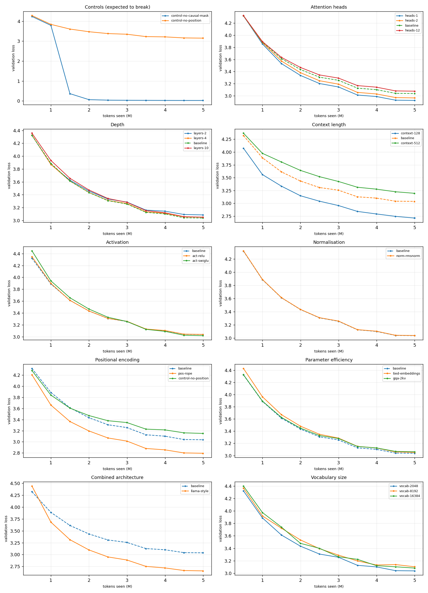
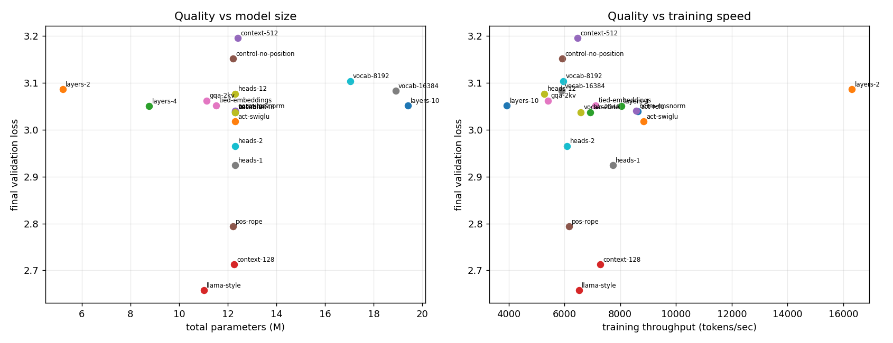

# LLM From Scratch: An Experimental Lab

A configurable GPT implemented in PyTorch, plus the experimental framework
needed to ask which of its design choices actually matter — and answer with
measurements rather than convention.

**23 controlled training runs** on TinyStories: 21 architecture ablations
(including two deliberate sabotage controls), a vocabulary study, and a LoRA
versus full fine-tuning comparison. Everything runs on a laptop; no GPU cluster,
no API keys.

---

## Why this exists

A basic transformer implementation produces a working model but offers little
evidence about which design choices matter. It cannot answer *why 12 heads*,
*why GELU*, or *does the causal mask actually matter*. Those questions need
experiments.

So the model here is deliberately configurable — every architectural choice is a
config field, never a code edit — and the project around it is a measurement
harness. An ablation is a config file; a result is a JSON record; a conclusion is
a number with a control behind it.

The transformer is the easy part. The evidence is the point.

---

## Headline results

**Llama-style components beat the GPT-style baseline by 32% perplexity**, with
*fewer* parameters:

| | val loss | perplexity | params |
|---|---|---|---|
| GPT-style baseline | 3.037 | 20.85 | 12.31M |
| **Llama-style** (RMSNorm + RoPE + SwiGLU + GQA) | **2.657** | **14.26** | **11.02M** |

Because RoPE was also ablated alone, that win decomposes: **rotary position
embeddings alone deliver −0.244 of the −0.380 total (64%)**. The remaining third
comes from RMSNorm, SwiGLU and grouped-query attention combined. Without the
separate run, the only available claim would be the vague "Llama-style is
better".

**Every capacity increase made things worse.** More heads, more layers, longer
context and larger vocabularies all cost quality on this corpus. Detail below.

---

## Setup

```bash
python3 -m venv venv && source venv/bin/activate
pip install -r requirements.txt

python tests/test_units.py                       # 51 assertions, CPU only
python experiments/train_tokenizers.py           # vocabulary study
python experiments/run.py --suite all            # 21 ablations (~4.5h)
python experiments/compare.py                    # table + plots
python experiments/finetune.py --pretrain        # base model for adaptation
python experiments/finetune.py                   # LoRA vs full fine-tuning
```

Trained on an Apple M2 (8GB, MPS). The full suite took 4h26m.

---

## Experiment 1 — vocabulary size

At this scale the embedding table, not the transformer, dominates the parameter
budget. With GPT-2's 50,257-token vocabulary at `emb_dim=384`, embeddings plus
an untied output head cost **38.6M parameters — 78% of a 49M model**, leaving
only ~10M doing any modelling.

A byte-level BPE tokenizer was therefore trained from scratch on the corpus:

| vocabulary | chars/token | embedding params | notes |
|---|---|---|---|
| 2,048 | 3.68 | 1.6M | |
| 8,192 | 4.17 | 6.3M | |
| 10,622 | 4.19 | 8.2M | **requested 16,384** |
| *GPT-2: 50,257* | — | *38.6M* | for reference |

Two findings:

**BPE saturated at 10,622 tokens.** Training stopped early because no character
pair occurred more than once any more — TinyStories genuinely has no further
structure to compress. Vocabulary budget cannot exceed what a corpus supports.

**Compression flattens hard.** 2K→8K buys 0.49 chars/token; 8K→10.6K buys
**0.02** for 2M extra parameters.

The practical payoff was large: switching from a 50K to a 2K vocabulary inverted
the parameter split (**86% transformer instead of 22%**) and made training
**4.6× faster** — 27,686 vs 6,025 tokens/sec. That speedup is what made a 21-run
ablation suite affordable at all.

Trained ablations then confirmed larger vocabularies do not help *quality*
either: `vocab-8192` scored +0.066 and `vocab-16384` +0.046 against the 2,048
baseline.

---

## Experiment 2 — architecture ablations

21 runs, each changing exactly one thing, all at an identical **5,000,000-token
budget**. Equal token budgets rather than equal epochs: context length is itself
an ablation, and a step processes `batch_size × context_length` tokens, so equal
steps would silently hand long-context runs more data.

### The controls come first

Two runs are deliberately sabotaged. They exist to prove the harness can detect
a real change — without them, every subtle result below would be unfalsifiable.

| control | val loss | perplexity | expected | observed |
|---|---|---|---|---|
| `control-no-causal-mask` | 0.024 | **1.02** | collapse | ✅ collapsed |
| `control-no-position` | 3.151 | 23.36 | worsen | ✅ +0.114 |

Removing the causal mask lets the model attend to the token it must predict, so
prediction becomes copying and perplexity falls to ~1. Had it *not* collapsed,
the masking implementation would be broken and every language-modelling number
in this repository meaningless. A unit test asserts the same property directly:
editing a later token must not change earlier outputs.

### Attention heads — fewer is better, monotonically

| heads | val loss | Δ | tok/s |
|---|---|---|---|
| **1** | **2.924** | **−0.114** | 7,734 |
| 2 | 2.965 | −0.072 | 6,093 |
| 6 (baseline) | 3.037 | ref | 6,925 |
| 12 | 3.076 | +0.039 | 5,277 |

Perfectly ordered across four runs, and one head was also the fastest. At
`emb_dim=384`, 12 heads leaves only 32 dimensions each; TinyStories does not
contain enough distinct relational structure to justify that many specialised
subspaces. This is a statement about the corpus, not about multi-head attention.

### Depth — bought nothing, cost 4× speed

| layers | val loss | Δ | params | tok/s |
|---|---|---|---|---|
| 2 | 3.086 | +0.049 | 5.22M | **16,309** |
| 4 | 3.050 | +0.013 | 8.77M | 8,040 |
| 6 (baseline) | 3.037 | ref | 12.31M | 6,925 |
| 10 | 3.051 | +0.014 | 19.41M | 3,930 |

All four land within 0.049 of each other while throughput varies **4×**. Ten
layers was *worse* than six. Two layers gives up 1.6% quality for a **2.4×**
speedup — the best efficiency trade in the suite.

### Context length — the largest single effect

| context | val loss | Δ |
|---|---|---|
| **128** | **2.712** | **−0.325** |
| 256 (baseline) | 3.037 | ref |
| 512 | 3.195 | +0.158 |

The biggest non-control effect measured, and shorter won decisively. TinyStories
average roughly 200 words, so a 256-token window regularly straddles a story
boundary and spends attention relating unconnected texts. A 128-token window
mostly stays inside one story. The same mechanism explains why 512 was the worst
non-control result — and why larger vocabularies, which pack more text into the
same window, also hurt.

### Activation and normalisation — free speed

| variant | val loss | Δ | tok/s |
|---|---|---|---|
| GELU (baseline) | 3.037 | ref | 6,925 |
| ReLU | 3.039 | +0.002 | **8,634** |
| SwiGLU | **3.018** | −0.020 | **8,840** |
| RMSNorm | 3.040 | +0.002 | **8,574** |

Quality differences here are within noise. The speed differences are not:
SwiGLU ran **28% faster** than GELU and RMSNorm **24%** faster than LayerNorm at
equal quality. Both are free wins at this scale.

### Positional encoding — where the real gain is

| variant | val loss | Δ |
|---|---|---|
| learned (baseline) | 3.037 | ref |
| **RoPE** | **2.794** | **−0.244** |
| none (control) | 3.151 | +0.114 |

RoPE encodes position by rotating queries and keys, so attention depends on the
*difference* between positions rather than on absolute learned vectors. It also
removes the position embedding table entirely.

### Parameter efficiency

| variant | val loss | Δ | params |
|---|---|---|---|
| baseline | 3.037 | ref | 12.31M |
| tied embeddings | 3.052 | +0.014 | 11.53M |
| grouped-query (2 KV heads) | 3.062 | +0.024 | 11.13M |

Tying input and output embeddings removed ~780k parameters for +0.014 loss —
close to free. GQA cost +0.024 for its memory saving, the expected direction.

### Everything together

| | val loss | perplexity | params | tok/s |
|---|---|---|---|---|
| GPT-style baseline | 3.037 | 20.85 | 12.31M | 6,925 |
| **Llama-style** | **2.657** | **14.26** | **11.02M** | 6,524 |

Better, smaller, and comparably fast.




---

## Experiment 3 — LoRA vs full fine-tuning

The pretrained TinyStories model was adapted to nineteenth-century literary prose
(Sherlock Holmes, Pride and Prejudice, Frankenstein) — same language, very
different register — under an identical 1.5M-token budget.

| metric | full fine-tuning | LoRA (r=8, q/v projections) |
|---|---|---|
| trainable parameters | 12,311,808 (100%) | **73,728 (0.595%)** |
| optimiser state | 98.49 MB | **0.59 MB** |
| throughput | 4,534 tok/s | **5,893 tok/s** |
| wall time | 331s | **254s** |
| **new** domain loss | **3.842** | 4.890 |
| **original** domain loss | 5.250 | **3.870** |

**Adaptation:** full fine-tuning improved the new domain by −2.062; LoRA by
−1.014. With 167× more trainable parameters, it should.

**Forgetting:** the original domain degraded by **+2.240** under full
fine-tuning and **+0.861** under LoRA. Full fine-tuning largely destroyed the
model's original capability; LoRA retained most of it.

The trace shows it happening step by step — full fine-tuning's original-domain
loss climbs monotonically (4.745 → 4.822 → 5.186 → 5.276 → 5.355) while its
new-domain loss falls.

This is the real engineering trade, and it is why one frozen base with many
task-specific adapters is a practical serving pattern: LoRA is not "cheaper
fine-tuning with the same result", it buys retention at the cost of plasticity.

---

## What is implemented

```
src/lm/
  config.py      every ablation switch, as dataclass fields
  tokenizer.py   byte-level BPE, trained from scratch, lossless round-trip
  model.py       configurable GPT (see matrix below)
  data.py        tokenisation with disk caching, token-budget batching
  train.py       one measured training loop for every experiment
  lora.py        low-rank adapters, with merge-back
experiments/     tokenizer study, ablation suite, comparison, fine-tuning
tests/           51 assertions, CPU only
```

| component | variants |
|---|---|
| normalisation | LayerNorm, RMSNorm |
| activation | GELU, ReLU, SiLU, SwiGLU |
| position | learned, RoPE, none *(control)* |
| attention | multi-head, grouped-query |
| masking | causal, unmasked *(control)* |
| embeddings | tied, untied |

The baseline architecture is the standard GPT design. What is specific to this
project is the configurability, the variants, the two controls, the measurement
harness, the tokenizer, and the experiments.

---

## Limitations

- **One seed per configuration.** Differences under ~0.02 loss (GELU vs ReLU,
  LayerNorm vs RMSNorm) are within run-to-run noise and are reported as ties
  rather than rankings. Confirming them needs multiple seeds.
- **One corpus.** Every result is about TinyStories: short, simple, narrow
  vocabulary. The "smaller is better" findings almost certainly reverse on
  harder text, and should not be read as general claims.
- **Small scale.** 12M parameters and 5M training tokens — roughly 14,000×
  smaller than GPT-3 on 60,000× less text. The scale is what makes a 21-run
  controlled suite possible; it is not a claim of competitive modelling.
- **`peak_memory_mb` under-reports on MPS**, which exposes current rather than
  peak allocation.
- **Fine-tuning uses the TinyStories tokenizer on Victorian prose**, so part of
  the measured domain gap is tokenizer mismatch rather than model adaptation.

## Data

The experiments use TinyStories by Eldan and Li (Microsoft Research) and
public-domain texts from Project Gutenberg.
